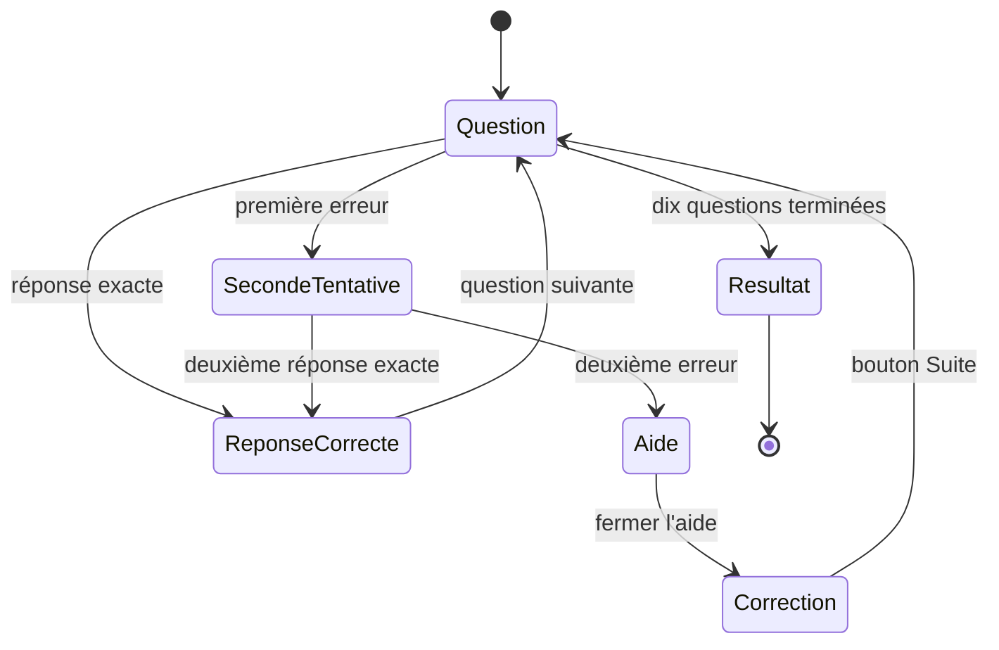

# Fiche fonctionnelle du pilote

**Pilote :** 6e — Numérique — chapitre 1 — série 1 — exercice 2  
**Intitulé historique :** « Quel est le chiffre des ... ? »  
**Statut :** spécification mise à jour selon les orientations pédagogiques du porteur du projet ; le portage HTML5 n'a pas encore commencé.

## 1. Délimitation du pilote

L'URL fournie, `pages/numerique/chap1/serie1/index.html`, est la page d'une série comportant plusieurs exercices. Les captures montrent le bouton **Exercice n° 2**. Le premier portage porte donc sur l'exercice 2, situé dans `pages/numerique/chap1/serie1/exo2/`, pas sur les sept exercices de la série.

Le contenu source du MVP pilote vient de l'archive Mathenpoche 6e. Le niveau d'archive indique la provenance et le classement du contenu, pas le niveau de difficulté imposé à l'élève. Cette activité de numération doit pouvoir être réglée pour des élèves du CP à la 6e ; le menu de difficulté choisit l'ordre de grandeur des nombres indépendamment du niveau de catalogue.

Dans le parcours sur les nombres entiers naturels, cet exercice décontextualisé occupe la phase d'entraînement entre un jeu sérieux de découverte et un jeu sérieux final d'évaluation du transfert. La conception de ces deux jeux et les principes pédagogiques du parcours sont décrits dans [`STRATEGIE-PEDAGOGIQUE.md`](STRATEGIE-PEDAGOGIQUE.md) ; ils restent à concevoir séparément.

Fichiers repérés dans les archives locales :

- SWF : `6eme/pages/numerique/chap1/serie1/exo2/N1s1ex2.swf` ;
- correction/animation associée : `6eme/pages/numerique/chap1/serie1/exo2/N1s1ex2_an.swf` ;
- tableau de numération historique : `6eme/pages/numerique/chap1/serie1/exo2/tab_entiers.swf` ;
- page HTML : `6eme/pages/numerique/chap1/serie1/exo2/exo2.htm` ;
- sources FLA : `6eme/6N1s1ex2.fla` et `6eme/6N1s1ex2_an.fla`.

La page HTML référence aussi `gestion/numero.php?code=6N1s1ex2`, un ancien service serveur. Cette dépendance devra être comprise ou remplacée par un identifiant local dans le fork. La source FLA est présente, mais son ActionScript n'a pas encore été extrait ni analysé.

## 2. Objectif pédagogique

À partir d'un nombre entier naturel, l'élève identifie le chiffre situé à un rang donné (unités, dizaines, centaines, unités de mille, etc.). L'activité distingue le **chiffre** de la position de sa valeur dans le nombre. Le tableau de numération sert d'aide visuelle pour repérer les rangs.

## 3. Déroulement fonctionnel

Une session comporte dix questions. Chaque question affiche un entier et demande le chiffre d'un rang. Le nombre et le rang sont tirés de façon à produire une question répondable dans le profil de difficulté choisi.

### Réponses et retours

- Réponse correcte au premier ou au second essai : afficher **« Bravo ! »** et attribuer l'unique point de la question. Une question ne peut rapporter qu'un point.
- En mode Entraînement, une première réponse incorrecte affiche **« Faux ! Encore un essai ! Utilise l'aide ! »**. En mode Évaluation, elle affiche **« Réponse incorrecte. Essaie encore. »**. Dans les deux cas, la question reste ouverte pour un second essai et une réponse ne peut pas être validée en double pendant l'affichage du retour.
- Deuxième réponse incorrecte consécutive sur la même question : afficher **« Non ! Regarde bien l'aide ! »**, ne pas attribuer le point de cette question et ouvrir la séquence d'aide. Après l'aide, montrer la correction et le bouton **« Suite »** ; l'élève passe alors à la question suivante.
- En mode Évaluation, après deux erreurs sur une question, ne pas attribuer son point, afficher **« Réponse incorrecte. Passe à la question suivante. »** et le bouton **« Suite »**. Le clic sur **Suite** ouvre la question suivante ; si la question terminée était la dixième, il ouvre l'écran final avec le score et l'appréciation.
- En mode Entraînement, l'élève peut aussi ouvrir l'aide avant de se tromper. Cette commande n'est pas proposée en mode Évaluation.
- Après dix questions, afficher le score final sur 10.

Les captures montrent un compteur intermédiaire sous la forme « points obtenus sur questions terminées » (par exemple `5 sur 7`). Ainsi, après six réussites puis deux erreurs à la septième question, le score est `6 sur 7` : le point de la septième question n'est pas gagné et aucun point déjà obtenu n'est retiré. Une réussite au second essai rapporte le point de la question. Le score est donc toujours compris entre zéro et le nombre de questions terminées ; il n'existe pas de pénalité soustraite au cumul antérieur.

### Principe de mesure de la maîtrise

Une première erreur isolée peut être une inattention ; elle ne suffit pas à conclure à une non-maîtrise. Deux erreurs consécutives sur une question indiquent un doute suffisamment fort pour ne pas attribuer le point correspondant. Le taux de réussite donne un indicateur de maîtrise de l'activité évaluée. Il ne doit pas être présenté comme une mesure universelle du niveau en mathématiques.

À la fin de l'exercice, afficher le taux de réussite et l'appréciation correspondante :

| Résultat sur 10 | Appréciation |
| ---: | --- |
| 0 à 4 (moins de 50 %) | Performance très insuffisante |
| 5 à 7 (de 50 % à moins de 80 %) | Performance insuffisante |
| 8 à 9 (de 80 % à moins de 100 %) | Performance satisfaisante |
| 10 (100 %) | Performance très satisfaisante |

### Validation du niveau de compétence

Un niveau de compétence correspond à la réussite de cette activité pour un profil de difficulté défini : CP, CE1, CE2, CM1, CM2 ou 6e. Le niveau est validé lorsque l'élève termine l'exercice avec au moins **80 %** de réussite. Pour le pilote de dix questions, cela représente au moins 8/10 ; le même seuil s'applique aux autres exercices, par exemple 4/5.

Une évaluation interrompue par l'expiration du chronomètre n'est pas une tentative complète et ne valide pas le niveau de compétence, même si le score partiel atteint 80 %. Les questions non répondues rapportent zéro point. L'écran final présente le résultat partiel et l'appréciation calculée, tandis que le tableau de bord garde le profil concerné comme **non validé**. L'élève doit s'entraîner, puis refaire l'exercice pour valider ce niveau. Une tentative complète sous le seuil de 80 % ne valide pas non plus le niveau.

Pour un élève connecté, enregistrer le résultat, le mode, le profil de difficulté et le statut de validation afin que le tableau de bord montre les niveaux atteints par activité et suive leur évolution. L'accès sans compte reste possible ; il n'enregistre pas de résultat nominatif dans Supabase.

## 4. Saisie et tableau de numération

- Une zone de saisie reçoit un chiffre unique, de 0 à 9.
- **Valider** et la touche **Entrée** déclenchent la même vérification.
- Le tableau de numération est disponible à la demande. Il est présenté en quatre classes — milliards, millions, mille, unités — chacune séparée en centaines, dizaines et unités.
- L'élève peut inscrire les chiffres dans les cases du tableau. Une action **Effacer** vide les cases. Le tableau aide à raisonner ; il ne remplace pas la réponse unique de la question.
- Le tableau reste utilisable au clavier et sur écran tactile. Une case ne prend qu'un chiffre et l'ordre de déplacement entre cases est logique, de gauche à droite.
- Le nombre est affiché avec des séparateurs de milliers lisibles en français, sans modifier sa valeur.

## 5. Séquence pédagogique d'aide

L'aide est une courte remédiation découpée en étapes. Chaque étape présente une explication ou une représentation du rang demandé.

- bouton vert **Précédent** pour relire l'étape précédente ;
- bouton vert **Suivant** pour avancer ;
- bouton rouge **Fermer** pour quitter l'aide ;
- état courant compréhensible (par exemple « étape 2 sur 4 ») ;
- après fermeture déclenchée par un second échec, présenter la correction et **Suite**.

Le portage peut remplacer l'animation Flash par une suite de diapositives HTML/SVG légère. L'objectif est de préserver la progression pédagogique, pas de reproduire les mécanismes Flash. Les commandes doivent être accessibles au clavier et respecter la préférence de réduction des animations.

## 6. Difficulté adaptative et réglages

L'activité mathématique (« identifier le chiffre occupant un rang donné ») est indépendante de la classe de l'archive qui la contient. Un menu absent de l'application historique permet de choisir un profil de difficulté initial, élève ou professeur selon le contexte. Le profil détermine l'ordre de grandeur des nombres, tandis que le contenu et l'objectif de l'activité restent les mêmes. En mode adaptatif, l'ordre de grandeur commence petit puis augmente progressivement lorsque l'élève réussit sans difficulté. Le professeur peut fixer un plafond et décider si l'élève peut le modifier.

| Profil proposé | Maximum inclusif fourni pour cadrer le profil |
| --- | ---: |
| CP | 100 |
| CE1 | 1 000 |
| CE2 | 1 000 000 |
| CM1 | 1 000 000 000 |
| CM2 | 999 999 999 999 |
| 6e | jusqu'à 999 999 999 999, capacité du tableau de numération à douze chiffres |

Les profils de difficulté correspondent aux niveaux d'études CP, CE1, CE2, CM1, CM2 et 6e. Les bornes numériques ci-dessus sont celles proposées pour cette activité. Le MVP utilise le contenu de l'archive Mathenpoche 6e ; le projet prévoit ensuite l'intégration des contenus des cinq niveaux du primaire. Un élève du primaire peut déjà utiliser le pilote avec le profil correspondant, sans attendre que l'archive de sa classe soit intégrée au catalogue.

### Politique adaptative proposée

La politique suivante est une proposition à valider avant le code :

1. En mode adaptatif, commencer dans une plage facile (nombres de 0 à 99), même si un plafond plus élevé est sélectionné.
2. Après deux réponses consécutives correctes au premier essai, avancer d'une plage de difficulté, sans dépasser le plafond choisi.
3. Une erreur suivie d'une réussite au second essai maintient la difficulté.
4. Deux questions consécutives terminées après ouverture de l'aide font baisser la difficulté d'une plage, sans descendre sous la difficulté de départ.
5. Ne jamais modifier le nombre d'une question en cours. Les changements de plage prennent effet à la question suivante.
6. En mode fixe, utiliser directement la plage choisie sans adaptation.

Les plages doivent être définies en fonction du nombre de chiffres et du rang interrogé, avec un mélange de rangs accessible au profil. Le générateur doit éviter les questions ambiguës et contrôler les zéros, les rangs disponibles, les bornes inclusives et les répétitions excessives.

## 7. Modes et réglages à proposer

- **Mode pédagogique :** Entraînement ou Évaluation.
- **Mode de difficulté :** adaptatif (par défaut en Entraînement) ou difficulté fixe.
- **Plafond :** CP, CE1, CE2, CM1, CM2 ou 6e.
- **Qui peut le modifier :** élève, ou professeur qui verrouille le réglage pour une activité attribuée.
- **Entraînement :** pas de chronomètre ; aide interactive et tableau de numération disponibles.
- **Évaluation :** exercice chronométré avec compte à rebours ; aide et tableau de numération désactivés. Les règles de score par question restent les mêmes.

Pour cet exercice, la durée maximale dépend du profil de difficulté : **15 minutes** pour CP, CE1 et CE2 ; **10 minutes** pour CM1, CM2 et 6e. Le compte à rebours est visible pendant l'évaluation. Ces durées sont des valeurs initiales et pourront être ajustées pendant les essais du MVP avec des élèves. À l'expiration, l'évaluation se termine ; les questions non répondues rapportent zéro point et le niveau de compétence reste non validé. Une évaluation effectuée avec un compte enregistre notamment le mode, le profil, le score, le taux de réussite, le statut de validation et la durée effective, pour le positionnement et le suivi dans les tableaux de bord.

En mode Évaluation, le premier retour est **« Réponse incorrecte. Essaie encore. »** ; aucun retour ne suggère d'utiliser l'aide, car elle est désactivée.

Les valeurs du menu peuvent évoluer après relecture pédagogique ; elles ne doivent pas être codées en dur dans la logique de génération.

## 8. Critères d'acceptation du portage

1. La page de série ouvre clairement l'exercice 2 ; l'exercice est identifié comme un pilote HTML5.
2. Une session produit dix questions et ne dépasse pas le plafond numérique choisi.
3. Une réponse correcte au premier ou au second essai affiche le retour convenu et attribue un point, sans dépasser un point par question.
4. Une première erreur laisse une seconde tentative ; une seconde erreur laisse la question à zéro point et, en Entraînement, lance l'aide puis conduit à la correction et à **Suite**.
5. La validation fonctionne avec le bouton et avec **Entrée** ; la même réponse ne peut pas être soumise deux fois par un double clic.
6. Le tableau de numération affiche les douze colonnes en quatre classes, accepte la saisie d'un chiffre par case et peut être effacé.
7. L'aide peut être parcourue dans les deux sens et fermée sans perdre l'état de la question.
8. Le mode adaptatif part d'une petite plage, progresse selon la politique validée et respecte toujours le plafond.
9. Les réglages restent modifiables par l'élève lorsqu'aucune consigne de professeur ne les verrouille.
10. En Évaluation, le compte à rebours est de 15 minutes pour CP–CE2 et de 10 minutes pour CM1–6e ; ni l'aide ni le tableau de numération ne sont accessibles.
11. En Évaluation, la première erreur affiche **« Réponse incorrecte. Essaie encore. »** ; deux erreurs affichent le second message convenu et **Suite**.
12. À expiration, les questions non répondues valent zéro et le profil de compétence reste non validé. Une tentative complète est nécessaire pour valider le profil avec au moins 80 % de réussite.
13. À la dernière question, **Suite** ouvre l'écran final avec score et appréciation.
14. Les actions principales sont accessibles au clavier et sur téléphone ; l'activité demeure jouable avec une connexion coupée après son chargement.

## 9. Points à trancher avant l'implémentation

- Valider avec les enseignants les profils CP–6e et la politique précise de montée/descente adaptative.
- Déterminer si une question réussie affiche **Suite** ou passe directement à la suivante ; les captures historiques documentent explicitement **Suite** après la correction d'un échec.
- Ajuster les durées de 15 et 10 minutes avec les élèves pendant les essais du MVP.
- Définir l'affichage et l'historique du statut de compétence dans les tableaux de bord, sans confondre résultat sur cette activité et niveau général en mathématiques.
- Décompiler/inspecter le SWF ou les FLA pour confirmer le nombre de questions, le choix des rangs, les règles de score et le contenu complet de l'aide.

