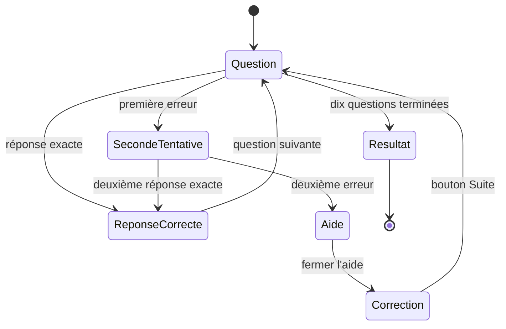

# Fiche fonctionnelle du pilote

**Pilote :** 6e — Numérique — chapitre 1 — série 1 — exercice 2  
**Intitulé historique :** « Quel est le chiffre des ... ? »  
**Statut :** spécification initiale, issue des indications de l'enseignant et des captures fournies ; le portage HTML5 n'a pas encore commencé.

## 1. Délimitation du pilote

L'URL fournie, `pages/numerique/chap1/serie1/index.html`, est la page d'une série comportant plusieurs exercices. Les captures montrent le bouton **Exercice n° 2**. Le premier portage porte donc sur l'exercice 2, situé dans `pages/numerique/chap1/serie1/exo2/`, pas sur les sept exercices de la série.

Fichiers repérés dans les archives locales :

- SWF : `6eme/pages/numerique/chap1/serie1/exo2/N1s1ex2.swf` ;
- correction/animation associée : `6eme/pages/numerique/chap1/serie1/exo2/N1s1ex2_an.swf` ;
- tableau de numération historique : `6eme/pages/numerique/chap1/serie1/exo2/tab_entiers.swf` ;
- page HTML : `6eme/pages/numerique/chap1/serie1/exo2/exo2.htm` ;
- sources FLA : `6eme/6N1s1ex2.fla` et `6eme/6N1s1ex2_an.fla`.

La page HTML référence aussi `gestion/numero.php?code=6N1s1ex2`, un ancien service serveur. Cette dépendance devra être comprise ou remplacée par un identifiant local dans le fork. La source FLA est présente, mais son ActionScript n'a pas encore été extrait ni analysé.

## 2. Objectif pédagogique

À partir d'un nombre entier naturel, l'élève identifie le chiffre situé à un rang donné (unités, dizaines, centaines, unités de mille, etc.). L'activité distingue le **chiffre** de la position de sa valeur dans le nombre. Le tableau de numération sert d'aide visuelle pour repérer les rangs.

## 3. Déroulement fonctionnel

Une session comporte dix questions. Chaque question affiche un entier et demande le chiffre d'un rang. Le nombre et le rang sont tirés de façon à produire une question répondable dans le profil de difficulté choisi.

### Réponses et retours

- Réponse correcte : afficher **« Bravo ! »**, ajouter un point et passer à la suite du parcours.
- Première réponse incorrecte : afficher **« Faux ! Encore un essai ! Utilise l'aide ! »**. La question reste ouverte pour un second essai et la réponse ne peut pas être validée en double pendant l'affichage du retour.
- Deuxième réponse incorrecte : afficher **« Non ! Regarde bien l'aide ! »**, retirer un point au score courant selon la règle demandée, puis ouvrir la séquence d'aide. Après l'aide, montrer la correction et le bouton **« Suite »** ; l'élève passe alors à la question suivante.
- L'élève peut aussi ouvrir l'aide avant de se tromper.
- Après dix questions, afficher le score final sur 10.

Les captures montrent un compteur intermédiaire sous la forme « score sur questions terminées » (par exemple `5 sur 7`) et une correction à consulter avant **Suite**. La version HTML5 conservera ce repère pendant l'activité, puis affichera le total sur 10 à la fin.

### Score à confirmer avant l'implémentation

La règle « retirer un point au score courant après deux erreurs » est reprise littéralement. La valeur minimale du score n'est pas précisée ; proposition prudente : ne jamais descendre sous zéro. Il faudra aussi figer le comportement si l'élève réussit au deuxième essai : proposition actuelle, accorder le point de la question, sans pénalité.

## 4. Saisie et tableau de numération

- Une zone de saisie reçoit un chiffre unique, de 0 à 9.
- **Valider** et la touche **Entrée** déclenchent la même vérification.
- Le tableau de numération est disponible à la demande. Il est présenté en quatre classes — milliards, millions, mille, unités — chacune séparée en centaines, dizaines et unités.
- L'élève peut inscrire les chiffres dans les cases du tableau. Une action **Effacer** vide les cases. Le tableau aide à raisonner ; il ne remplace pas la réponse unique de la question.
- Le tableau reste utilisable au clavier et sur écran tactile. Une case ne prend qu'un chiffre et l'ordre de déplacement entre cases est logique, de gauche à droite.
- Le nombre est affiché avec des séparateurs de milliers lisibles en français, sans modifier sa valeur.

## 5. Séquence pédagogique d'aide

L'aide est une courte remédiation découpée en étapes. Chaque étape présente une explication ou une représentation du rang demandé.

- bouton vert **Précédent** pour relire l'étape précédente ;
- bouton vert **Suivant** pour avancer ;
- bouton rouge **Fermer** pour quitter l'aide ;
- état courant compréhensible (par exemple « étape 2 sur 4 ») ;
- après fermeture déclenchée par un second échec, présenter la correction et **Suite**.

Le portage peut remplacer l'animation Flash par une suite de diapositives HTML/SVG légère. L'objectif est de préserver la progression pédagogique, pas de reproduire les mécanismes Flash. Les commandes doivent être accessibles au clavier et respecter la préférence de réduction des animations.

## 6. Difficulté adaptative et réglages

L'ordre de grandeur commence petit et augmente quand l'élève réussit sans difficulté. L'élève peut choisir un profil au démarrage. Le professeur peut choisir un plafond de difficulté pour un travail assigné et décider si l'élève peut le modifier.

| Profil proposé | Maximum inclusif fourni pour cadrer le profil |
| --- | ---: |
| CP | 100 |
| CE1 | 1 000 |
| CE2 | 1 000 000 |
| CM1 | 1 000 000 000 |
| CM2 | 999 999 999 999 |
| 6e | jusqu'à 999 999 999 999 dans le tableau à 12 chiffres ; plafond à confirmer avec l'exercice historique et un professeur |

Ces bornes sont celles communiquées pour ce projet. Elles doivent être relues pédagogiquement avant d'être présentées comme un référentiel officiel.

### Politique adaptative proposée

La politique suivante est une proposition à valider avant le code :

1. En mode adaptatif, commencer dans une plage facile (nombres de 0 à 99), même si un plafond plus élevé est sélectionné.
2. Après deux réponses consécutives correctes au premier essai, avancer d'une plage de difficulté, sans dépasser le plafond choisi.
3. Une erreur suivie d'une réussite au second essai maintient la difficulté.
4. Deux questions consécutives terminées après ouverture de l'aide font baisser la difficulté d'une plage, sans descendre sous la difficulté de départ.
5. Ne jamais modifier le nombre d'une question en cours. Les changements de plage prennent effet à la question suivante.
6. En mode fixe, utiliser directement la plage choisie sans adaptation.

Les plages doivent être définies en fonction du nombre de chiffres et du rang interrogé, avec un mélange de rangs accessible au profil. Le générateur doit éviter les questions ambiguës et contrôler les zéros, les rangs disponibles, les bornes inclusives et les répétitions excessives.

## 7. Réglages à proposer

- **Mode :** adaptatif (par défaut) ou difficulté fixe.
- **Plafond :** CP, CE1, CE2, CM1, CM2 ou 6e.
- **Qui peut le modifier :** élève, ou professeur qui verrouille le réglage pour une activité attribuée.
- **Aide :** disponible à la demande dans tous les modes.

Les valeurs du menu peuvent évoluer après relecture pédagogique ; elles ne doivent pas être codées en dur dans la logique de génération.

## 8. Critères d'acceptation du portage

1. La page de série ouvre clairement l'exercice 2 ; l'exercice est identifié comme un pilote HTML5.
2. Une session produit dix questions et ne dépasse pas le plafond numérique choisi.
3. Une réponse correcte au premier ou au second essai affiche le retour convenu et met à jour le score selon la règle validée.
4. Une première erreur laisse une seconde tentative ; une seconde erreur lance l'aide et conduit à la correction puis à **Suite**.
5. La validation fonctionne avec le bouton et avec **Entrée** ; la même réponse ne peut pas être soumise deux fois par un double clic.
6. Le tableau de numération affiche les douze colonnes en quatre classes, accepte la saisie d'un chiffre par case et peut être effacé.
7. L'aide peut être parcourue dans les deux sens et fermée sans perdre l'état de la question.
8. Le mode adaptatif part d'une petite plage, progresse selon la politique validée et respecte toujours le plafond.
9. Les réglages restent modifiables par l'élève lorsqu'aucune consigne de professeur ne les verrouille.
10. Les actions principales sont accessibles au clavier et sur téléphone ; l'activité demeure jouable avec une connexion coupée après son chargement.

## 9. Points à trancher avant l'implémentation

- Confirmer le plancher de score après une seconde erreur et le point attribué en cas de réussite au second essai.
- Confirmer le plafond numérique de 6e à partir de l'exercice historique.
- Valider les profils CP–6e et la politique de montée/descente adaptative avec un professeur.
- Déterminer si une question réussie affiche **Suite** ou passe directement à la suivante ; les captures historiques documentent explicitement **Suite** après la correction d'un échec.
- Décompiler/inspecter le SWF ou les FLA pour confirmer le nombre de questions, le choix des rangs, les règles de score et le contenu complet de l'aide.

