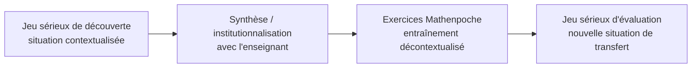

# Stratégie pédagogique du fork

## 1. Deux familles d'activités

Le fork organise les activités mathématiques en deux familles complémentaires :

1. **Exercices Mathenpoche décontextualisés** : exercices issus du corpus source, destinés à entraîner des savoir-faire, des techniques et des schèmes opératoires sur des tâches mathématiques explicites.
2. **Jeux sérieux de résolution de problèmes contextualisés** : situations originales dans lesquelles l'élève doit mobiliser des connaissances mathématiques pour agir, choisir une stratégie et résoudre un problème.

Un jeu sérieux n'est pas seulement un exercice traditionnel décoré d'un récit, de points ou d'animations. Le contexte, les règles et les rétroactions du jeu doivent rendre la connaissance ciblée utile à la résolution du problème.

## 2. Parcours d'apprentissage organisé par notion

Pour une notion donnée, le parcours de référence est :

Le jeu initial fait vivre une situation-problème qui permet à l'élève de construire des premières représentations de la notion. Une synthèse peut aider à mettre en mots et à stabiliser les connaissances construites ; elle soutient le rôle de l'enseignant et ne transforme pas le jeu en source unique du savoir.

Les exercices Mathenpoche consolident ensuite les savoir-faire et les schèmes opératoires associés. Le parcours se termine par un autre jeu contextualisé. Son scénario et ses données diffèrent de ceux du jeu initial, mais la situation fait intervenir le même modèle mathématique. Cette différence permet d'observer si l'élève sait transférer et réinvestir ses connaissances au-delà du contexte d'apprentissage.

## 3. Inspiration de la théorie des situations didactiques

La conception des jeux s'inspire de la théorie des situations didactiques (TSD) de Guy Brousseau. Le jeu doit être construit autour d'un savoir mathématique déterminé et d'un milieu avec lequel l'élève agit et qui lui fournit des rétroactions. La situation doit donner à l'élève une véritable responsabilité dans la recherche ; les mécanismes ludiques ne doivent pas révéler ou remplacer la stratégie mathématique attendue.

Les concepteurs et enseignants pourront notamment examiner :

- quelle connaissance mathématique est nécessaire pour agir et réussir ;
- ce que l'élève peut décider, essayer et observer dans le milieu du jeu ;
- si les rétroactions aident à adapter une stratégie sans donner immédiatement la procédure ;
- comment la situation permet la dévolution du problème à l'élève ;
- à quel moment l'enseignant met en mots et institutionnalise les connaissances construites ;
- en quoi le jeu final change le contexte tout en conservant le modèle mathématique à réinvestir.

Le projet parle d'une **inspiration** de la TSD : un jeu numérique ne constitue pas automatiquement une situation didactique au sens de Brousseau. Chaque jeu devra être conçu, décrit et relu avec un enseignant de mathématiques.

## 4. Exemple de parcours : les nombres entiers naturels

Le parcours de la notion des nombres entiers naturels pourra commencer par un jeu de résolution de problème où les nombres et leur organisation servent à prendre des décisions dans une situation concrète. L'élève pourra ensuite travailler les exercices de la série Mathenpoche 6e, dont le pilote **« Quel est le chiffre des… ? »** entraîne la connaissance de la valeur de position des chiffres. Le parcours se terminera par un nouveau jeu, dans un contexte différent, où la lecture et l'organisation des nombres sont nécessaires pour résoudre le problème.

Le niveau de difficulté est un choix indépendant de la provenance du contenu : pour cet exercice, les profils CP, CE1, CE2, CM1, CM2 et 6e règlent les ordres de grandeur des nombres. Le jeu d'évaluation de transfert doit également préciser les profils et les variables de difficulté qu'il propose.

## 5. Résultats et positionnement de l'élève

Les résultats distinguent au moins deux informations :

- **Maîtrise des savoir-faire** : résultat des exercices décontextualisés, associé à la notion et au profil de difficulté choisi. Pour les exercices à points, une tentative complète avec au moins 80 % de réussite valide le niveau correspondant ; une évaluation chronométrée incomplète ne le valide pas.
- **Réinvestissement / transfert** : résultat du jeu contextualisé final, associé à la même notion et à une situation nouvelle. Il constitue un indicateur distinct de la réussite aux exercices d'entraînement.

Les tableaux de bord pourront afficher l'état de maîtrise des exercices et les résultats de transfert séparément, puis présenter la progression du parcours par notion. Le barème ou la grille d'appréciation du jeu de transfert reste à définir pour chaque jeu ; le seuil de 80 % des exercices ne doit pas lui être appliqué automatiquement sans décision pédagogique.

L'accès libre sans compte reste possible. Pour les élèves connectés, les résultats peuvent être enregistrés afin que l'élève et son professeur suivent ces deux dimensions dans le temps, dans le respect des règles d'accès et de minimisation des données du cahier des charges.

## 6. Métadonnées nécessaires au catalogue

Chaque activité devra pouvoir être reliée à :

- un identifiant de notion ou de compétence ;
- son type : exercice Mathenpoche décontextualisé ou jeu sérieux contextualisé ;
- son rôle dans le parcours : découverte, entraînement, transfert/évaluation ;
- ses prérequis et les connaissances mathématiques mobilisées ;
- son niveau de difficulté scolaire (CP, CE1, CE2, CM1, CM2, 6e, etc.), indépendant du niveau de l'archive d'origine ;
- ses critères de réussite et les informations de progression à enregistrer ;
- pour un jeu, son contexte, son modèle mathématique, ses règles, ses rétroactions et les décisions de l'élève qu'il permet d'observer.

Le parcours peut référencer plusieurs exercices Mathenpoche pour la phase d'entraînement et un jeu distinct pour la découverte et le transfert. Les identifiants des jeux accompagnant le pilote seront renseignés au fur et à mesure de leur conception.

## Références pédagogiques

- [Guy Brousseau, *La théorie des situations didactiques — Le cours de Montréal, 1997*](https://ardm.eu/guy-brousseau/guy-brousseau.com/1694/la-theorie-des-situations-didactiques-le-cours-de-montreal-1997/index.html) — présentation de la dévolution et de l'institutionnalisation.
- [Guy Brousseau, *Le contrat didactique : le milieu*, Recherches en didactique des mathématiques](https://revue-rdm.com/1988/le-contrat-didactique-le-milieu/) — milieu et interactions de l'élève avec la situation.
