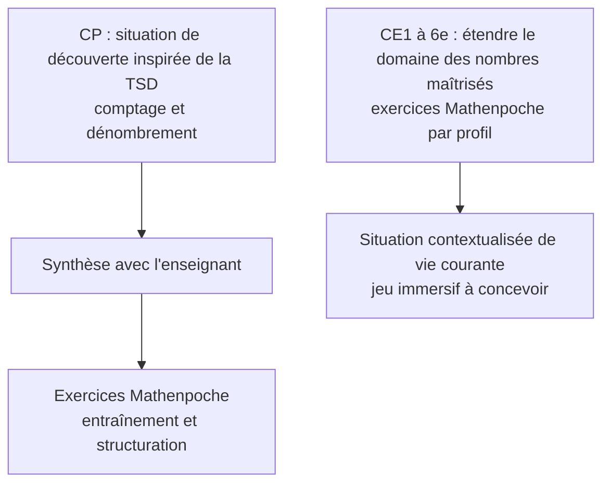

# Stratégie pédagogique du fork

## 1. Deux familles d'activités

Le fork organise les activités mathématiques en deux familles complémentaires :

1. **Exercices Mathenpoche décontextualisés** : exercices issus du corpus source, destinés à entraîner des savoir-faire, des techniques et des schèmes opératoires sur des tâches mathématiques explicites.
2. **Jeux sérieux de résolution de problèmes contextualisés** : situations originales dans lesquelles l'élève doit mobiliser des connaissances mathématiques pour agir, choisir une stratégie et résoudre un problème.

Un jeu sérieux n'est pas seulement un exercice traditionnel décoré d'un récit, de points ou d'animations. Le contexte, les règles et les rétroactions du jeu doivent rendre la connaissance ciblée utile à la résolution du problème.

## 2. Parcours organisé par notion et niveau d'études

Le parcours dépend du niveau d'études et de l'état de conceptualisation visé. Il ne faut pas imposer un jeu de découverte identique à toutes les classes.

Au CP, le jeu inspiré de la TSD vise la conceptualisation initiale du nombre naturel, du comptage et du dénombrement. Il peut être suivi d'une synthèse conduite par l'enseignant et d'exercices d'entraînement. Un éventuel jeu contextualisé après l'entraînement au CP n'est pas spécifié à ce stade.

À partir du CE1 et jusqu'à la 6e, le projet part de l'hypothèse que les propriétés primitives des nombres naturels sont déjà conceptualisées. L'enjeu des activités Mathenpoche devient l'extension du domaine de nombres maîtrisés, au moyen de profils de difficulté correspondant à la classe. Un jeu contextualisé propose ensuite le réinvestissement de ces connaissances dans une situation de vie courante. Son modèle pédagogique ne sera pas copié sur le jeu TSD destiné au CP.

| Public visé | Enjeu sur les nombres naturels | Modèle de jeu contextualisé envisagé | Évaluation |
| --- | --- | --- | --- |
| CP | Conceptualiser initialement le comptage et le dénombrement | Situation inspirée de la situation fondamentale décrite par Brousseau | Relire les stratégies, les erreurs et les rétroactions avec un enseignant |
| CE1 à 6e | Étendre le domaine de nombres maîtrisés avec les exercices Mathenpoche, puis les réinvestir | Personnage 3D guidé par les flèches du clavier dans un quartier ; atteindre la maison correspondant à une adresse numérotée | Définir les indicateurs après prototypage et observation des élèves |

## 3. Jeu de conceptualisation initiale au CP : inspiration de la TSD

Dans la Partie III, « L'exemple des nombres naturels », de sa conférence de 2004 à l'Université de Genève, Guy Brousseau décrit une situation fondamentale de dénombrement : l'enfant doit se procurer en un seul déplacement une collection équipotente à une collection éloignée, sans manque ni surplus. Dans une variante de communication, un élève demande à un autre la quantité nécessaire par un message, puis les rôles d'émetteur et de récepteur sont inversés.

Cette situation constitue une référence pour concevoir le jeu de conceptualisation initiale au CP. Elle ne se réduit pas à faire réciter la suite des nombres ou à répondre à une batterie de questions. La situation doit rendre nécessaire un moyen fiable de dénombrer et permettre à l'élève d'observer si sa stratégie satisfait la contrainte du jeu.

Les variables de conception à explorer incluent la taille et la disposition des collections, la mobilité des objets, la distance entre les collections, la contrainte d'un seul déplacement, les moyens de représenter une collection et la possibilité de transmettre un message. Ces paramètres peuvent faire évoluer les stratégies, de la correspondance terme à terme vers l'énumération, le comptage, la formulation orale ou écrite d'une quantité et la notation numérique.

Le jeu doit laisser à l'élève une responsabilité réelle dans la recherche et fournir des rétroactions pertinentes par l'intermédiaire du milieu. Les mécanismes ludiques ne doivent pas révéler ou remplacer la stratégie mathématique attendue. La synthèse de l'enseignant peut ensuite expliciter et institutionnaliser des connaissances construites pendant l'action.

Les concepteurs et enseignants pourront notamment examiner :

- quelle connaissance mathématique est nécessaire pour agir et réussir ;
- ce que l'élève peut décider, essayer et observer dans le milieu du jeu ;
- si les rétroactions aident à adapter une stratégie sans donner immédiatement la procédure ;
- comment la situation permet la dévolution du problème à l'élève ;
- à quel moment l'enseignant met en mots et institutionnalise les connaissances construites ;
- quelles connaissances la situation permet de construire, puis comment elles seront mises en mots et réinvesties aux étapes suivantes.

Le projet parle d'une **inspiration** de la TSD : un jeu numérique ne constitue pas automatiquement une situation didactique au sens de Brousseau. La situation fondamentale est principalement destinée au début de la conceptualisation, notamment au CP ; le document rappelle aussi que l'apprentissage des nombres naturels est long et ne repose pas exclusivement sur une situation fondamentale. Le jeu doit être conçu, décrit et relu avec un enseignant de mathématiques.

## 4. Activités contextualisées après le CP

Pour les élèves des niveaux plus avancés, un modèle envisagé est un jeu immersif en 3D dans lequel l'élève déplace un personnage avec les flèches du clavier dans les rues d'un quartier. Les maisons portent des numéros ; le joueur doit guider le personnage jusqu'à la résidence dont l'adresse lui a été donnée.

Ce scénario est une piste de conception, pas encore une évaluation spécifiée. Le prototype devra être développé puis observé avec des élèves. L'équipe analysera quelles connaissances sont effectivement mobilisées (lecture, comparaison, ordre, valeur de position ou autres) et quelles décisions sont observables. Les modalités et critères d'évaluation ne seront définis qu'à partir de cette analyse ; ils ne sont pas fixés a priori.

Le niveau de difficulté des exercices Mathenpoche correspond aux classes CP, CE1, CE2, CM1, CM2 et 6e. Pour le pilote **« Quel est le chiffre des… ? »**, le profil choisi règle notamment l'ordre de grandeur des nombres ; l'activité de la source 6e peut ainsi être utilisée par un élève du primaire avec un profil correspondant.

## 5. Résultats et positionnement de l'élève

Les résultats distinguent au moins deux informations :

- **Maîtrise des savoir-faire** : résultat des exercices décontextualisés, associé à la notion et au profil de difficulté choisi. Pour les exercices à points, une tentative complète avec au moins 80 % de réussite valide le niveau correspondant ; une évaluation chronométrée incomplète ne le valide pas.
- **Réinvestissement en contexte** : trace de l'activité de l'élève dans un jeu contextualisé, associée à la notion et à la situation proposée. Pour les jeux des niveaux plus avancés, les observations des élèves serviront d'abord à déterminer ce qu'il est pertinent d'évaluer.

Les tableaux de bord pourront afficher l'état de maîtrise des exercices et les résultats en contexte séparément, puis présenter la progression par notion et par profil d'études. Le seuil de 80 % défini pour les exercices ne s'applique pas automatiquement aux jeux sérieux ; leur évaluation demeure à définir après conception et observation.

L'accès libre sans compte reste possible. Pour les élèves connectés, les résultats peuvent être enregistrés afin que l'élève et son professeur suivent ces deux dimensions dans le temps, dans le respect des règles d'accès et de minimisation des données du cahier des charges.

## 6. Métadonnées nécessaires au catalogue

Chaque activité devra pouvoir être reliée à :

- un identifiant de notion ou de compétence ;
- son type : exercice Mathenpoche décontextualisé ou jeu sérieux contextualisé ;
- son rôle dans le parcours : conceptualisation initiale, entraînement ou réinvestissement contextualisé ;
- ses prérequis et les connaissances mathématiques mobilisées ;
- son niveau de difficulté scolaire (CP, CE1, CE2, CM1, CM2, 6e, etc.), indépendant du niveau de l'archive d'origine ;
- ses critères de réussite et les informations de progression à enregistrer ;
- pour un jeu, son contexte, son modèle mathématique, ses règles, ses rétroactions et les décisions de l'élève qu'il permet d'observer.

Le parcours peut référencer les jeux et exercices pertinents selon le niveau d'études. Pour la notion des nombres naturels, le jeu de conceptualisation inspiré de la TSD vise le CP ; un scénario immersif de réinvestissement est envisagé pour les niveaux plus avancés. Les identifiants, profils, rôles et critères des jeux seront renseignés au fur et à mesure de leur conception et de leur observation avec les élèves.

## Références pédagogiques

- [Guy Brousseau, *Des dispositifs d'apprentissage aux situations didactiques en mathématiques*, conférence à l'Université de Genève, 3 juin 2004](https://ardm.eu/guy-brousseau/guy-brousseau.com/2508/des-dispositifs-dapprentissage-aux-situations-didactiques-en-mathematiques-2004/index.html) — Partie III, « L'exemple des nombres naturels » ; décrit la situation fondamentale du dénombrement et le développement progressif des connaissances sur les nombres naturels.
- [Guy Brousseau, *La théorie des situations didactiques — Le cours de Montréal, 1997*](https://ardm.eu/guy-brousseau/guy-brousseau.com/1694/la-theorie-des-situations-didactiques-le-cours-de-montreal-1997/index.html) — présentation de la dévolution et de l'institutionnalisation.
- [Guy Brousseau, *Le contrat didactique : le milieu*, Recherches en didactique des mathématiques](https://revue-rdm.com/1988/le-contrat-didactique-le-milieu/) — milieu et interactions de l'élève avec la situation.
